# NFS Hung Storage & D-State Process Investigation

## Objective

Simulate an NFS server/storage outage and investigate a client process that becomes stuck in **D-state (uninterruptible sleep)** while waiting for NFS I/O to complete.

This lab demonstrates a production-style troubleshooting flow:

**Network → NFS export → RPC → mount → I/O → D-state → kill failure → I/O wait → recovery**

---

## Lab Architecture

| Role | Host | IP |
|---|---|---|
| NFS Server | Rocky Linux 10 | `192.168.1.124` |
| NFS Client | Rocky Linux 10 | `192.168.1.118` |
|
| Network | VirtualBox NAT / host lab network | Both hosts reachable |

> Both machines used Rocky Linux 10 in this lab. The exact IPs can be changed for another lab environment.

---

# Part 1 — Configure the NFS Server

## 1. Install NFS utilities

On the **NFS server**:

```bash
dnf install nfs-utils -y
```

This installs the NFS server/client utilities and related RPC components.

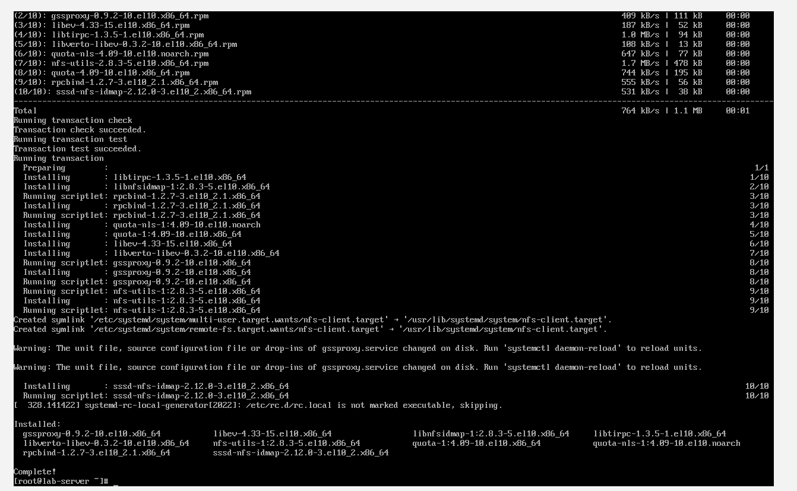

---

## 2. Create the NFS share

```bash
mkdir /share
chmod 777 /share
```

- `/share` is the directory we will export.
- `chmod 777` is used only to keep permissions simple for this lab.
- In production, use appropriate ownership and permissions instead of `777`.

![Incident 005 – NFS Server and Client Configuration(02-create-share.png)

---

## 3. Configure `/etc/exports`

Edit the NFS export configuration:

```bash
vi /etc/exports
```

Add:

```text
/share *(rw,sync,no_root_squash)
```

### Meaning

- `/share` → directory being exported.
- `*` → allow clients from any address for this lab.
- `rw` → read/write access.
- `sync` → write operations are committed synchronously.
- `no_root_squash` → client root remains root for this lab.

> `*` and `no_root_squash` are intentionally permissive for a lab. Do not copy this configuration blindly into production.

Apply the export configuration:

```bash
exportfs -rv
```

Expected:

```text
exporting *:/share
```

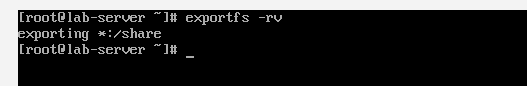

---

## 4. Start the NFS server

```bash
systemctl enable --now nfs-server
```

Verify:

```bash
systemctl status nfs-server
```

On this Rocky Linux 10 lab, `nfs-server.service` may show **active (exited)**. This is normal for this service because it starts the underlying NFS components and then exits.

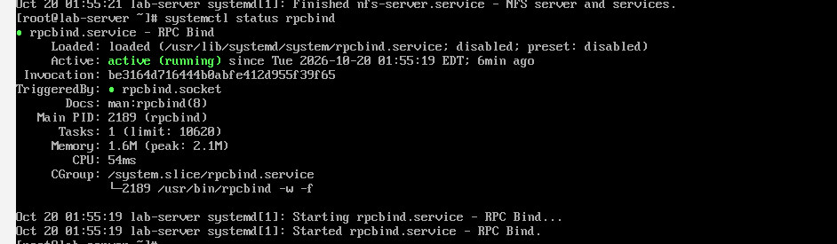

---

# Part 2 — Configure the NFS Client

## 5. Install NFS utilities

On the **client**:

```bash
dnf install nfs-utils -y
```

Create the mount point:

```bash
mkdir /mnt/share
```

---

## 6. Verify the export from the client

```bash
showmount -e 192.168.1.124
```

Expected:

```text
Export list for 192.168.1.124:
/share *
```

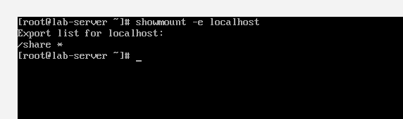

If this fails with an RPC-related error, check:

```bash
systemctl status rpcbind
systemctl status nfs-server
```

On this lab, `rpcbind` was running after it was enabled/started.

---

## 7. Check firewall if RPC/NFS access fails

```bash
systemctl status firewalld
```

If the firewall is blocking the lab traffic, troubleshoot the firewall rules rather than permanently disabling security controls.

For a temporary lab test only, you can stop it:

```bash
systemctl stop firewalld
```

> In production, configure the required NFS/RPC firewall rules instead of disabling `firewalld`.

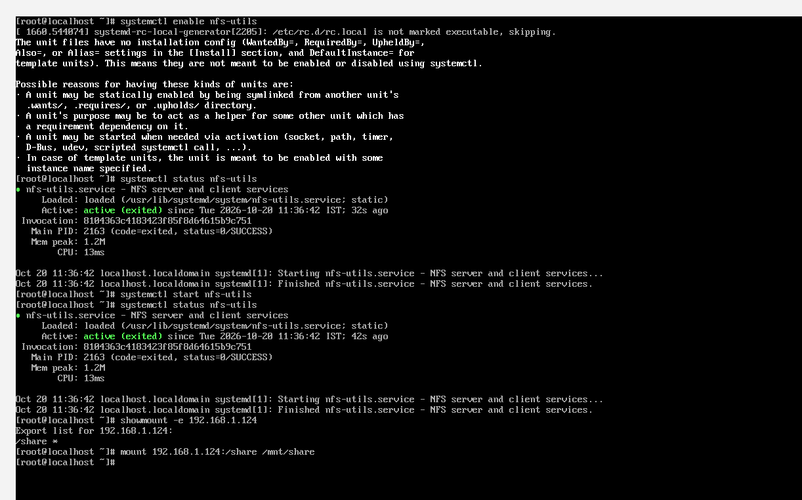

---

## 8. Mount the NFS share

On the client:

```bash
mount 192.168.1.124:/share /mnt/share
```

Verify:

```bash
df -h
mount | grep share
```

Expected mount:

```text
192.168.1.124:/share on /mnt/share type nfs4 ...
```

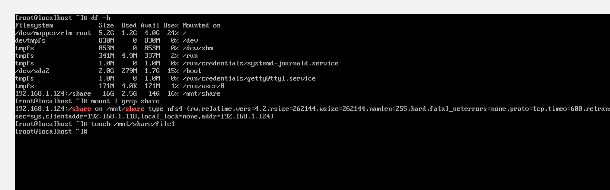

---

## 9. Verify read/write access

Client:

```bash
touch /mnt/share/file1
```

Server:

```bash
ls -l /share
```

The file created on the client should appear on the NFS server.

This proves that the NFS mount is actually providing remote storage access.

---

# Part 3 — Generate Storage I/O

## 10. Start a continuous write operation

On the client:

```bash
dd if=/dev/zero of=/mnt/share/bigfile bs=1M status=progress
```

### What the command means

- `if=/dev/zero` → generates zero-filled data.
- `of=/mnt/share/bigfile` → writes to the NFS-mounted filesystem.
- `bs=1M` → writes in 1 MiB blocks.
- `status=progress` → displays progress.

The important point is that **`bigfile` is being written to NFS storage, not the client's local disk**.

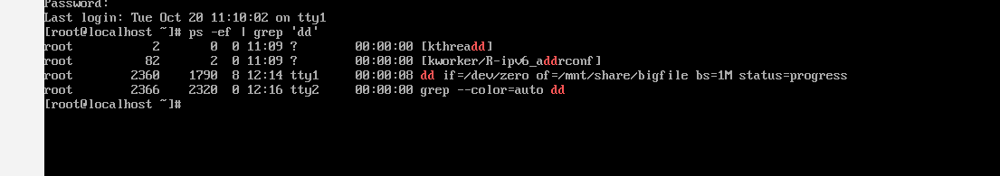

---

# Part 4 — Simulate an NFS/Storage Failure

## 11. Stop the NFS server

On the NFS server:

```bash
systemctl stop nfs-server
```

This simulates an NFS server/storage outage.

Do **not** kill the `dd` process manually.

---

## 12. Check the `dd` process on the client

Use a second console/TTY on the client because SSH was not enabled in this lab.

Switch to another virtual console with:

```text
Ctrl + Alt + F2
```

Log in and run:

```bash
ps -o pid,stat,cmd -C dd
```

The process should appear similar to:

```text
PID   STAT  CMD
2360  D+    dd if=/dev/zero of=/mnt/share/bigfile ...
```

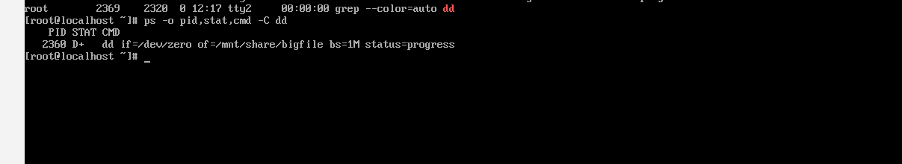

---

# Part 5 — Understand D-State

## What does `D` mean?

`D` means **uninterruptible sleep**.

The process is waiting inside the kernel for an I/O operation to complete.

In this lab:

```text
dd
 ↓
NFS-mounted filesystem
 ↓
NFS server unavailable
 ↓
I/O request cannot complete
 ↓
dd enters D-state
```

The process is not simply "sleeping normally". It is blocked waiting for the kernel-level I/O operation.

---

# Part 6 — Prove that SIGKILL Does Not Immediately Work

Try:

```bash
kill 2360
```

Then:

```bash
ps -o pid,stat,cmd -C dd
```

Now try the stronger signal:

```bash
kill -9 2360
```

Again:

```bash
ps -o pid,stat,cmd -C dd
```

The process remains in `D+` state.

### Why?

`kill -9` sends **SIGKILL**, but a process stuck in an uninterruptible kernel I/O wait cannot immediately process that signal.

A better interview statement is:

> **SIGKILL cannot take effect while the process is stuck in an uninterruptible kernel I/O wait. If the I/O operation eventually returns, the pending signal can then be processed.**


---

# Part 7 — Investigate the System

## 13. Check CPU and process activity

```bash
top
```

The `dd` process may not be immediately obvious on the visible portion of the screen. Use `ps` for a direct process check.

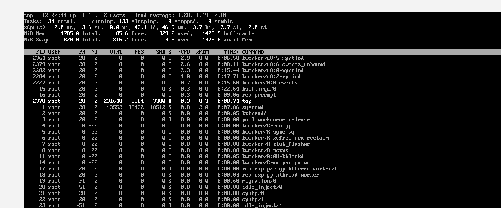

---

## 14. Check I/O wait

```bash
vmstat 1
```

Important columns:

- `b` → processes blocked waiting for resources/I/O.
- `wa` → percentage of CPU time waiting for I/O.

During the outage, this lab showed sustained/high `wa` values, consistent with the blocked NFS I/O.

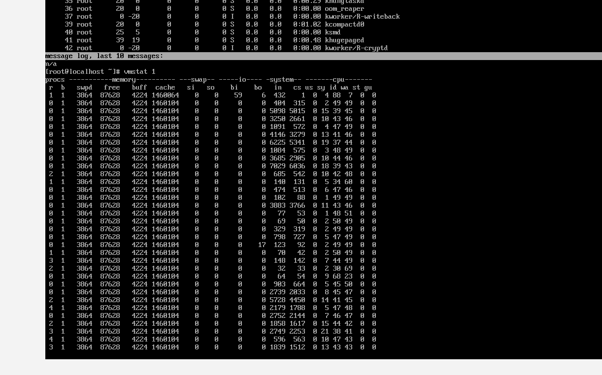

---

## 15. Check kernel messages

```bash
dmesg | tail -20
```

The exact output depends on the kernel and the failure scenario. In this run, the tail contained a kernel stack trace rather than a clean NFS error message, so it was not treated as the primary evidence.

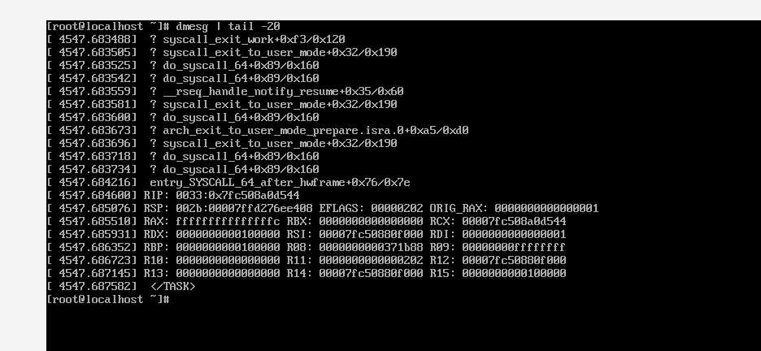

You can also investigate with:

```bash
journalctl -f
```

and search for NFS, RPC, network, or storage-related messages.

---

# Part 8 — Recover the NFS Server

## 16. Restore NFS

On the NFS server:

```bash
systemctl start rpcbind
systemctl start nfs-server
```

Verify:

```bash
systemctl status rpcbind
systemctl status nfs-server
```

> On this Rocky Linux 10 system, the correct service name is `rpcbind`, not `rpc-bind` or `rpc-bind.service`.

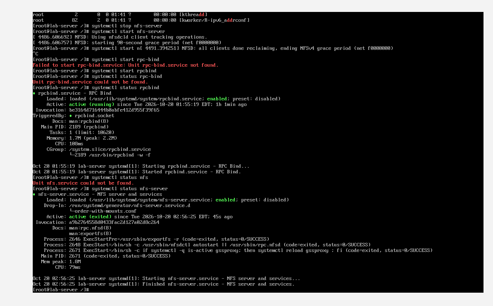

---

## 17. Check the client again

On the client:

```bash
ps -o pid,stat,cmd -C dd
```

After the NFS I/O path is restored, the blocked operation can complete and the `dd` process can exit.

In this run, PID `2360` was no longer present after recovery.

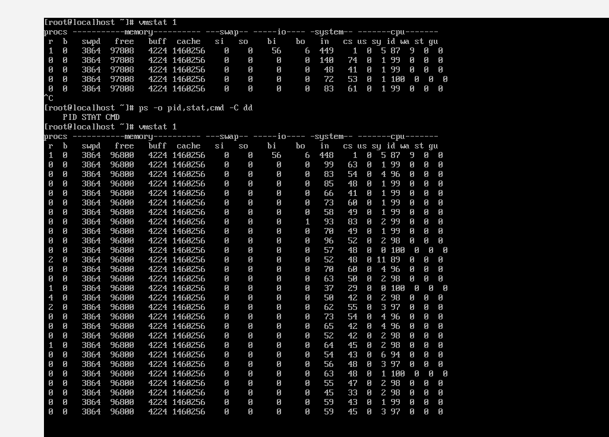

---

# Troubleshooting Flow

When an NFS-backed application hangs, do not immediately reboot the server/client.

Use this sequence:

```text
1. Confirm network connectivity
       ↓
2. Check NFS server status
       ↓
3. Check rpcbind/RPC
       ↓
4. Check /etc/exports
       ↓
5. Check exportfs -rv / showmount
       ↓
6. Check firewall/SELinux
       ↓
7. Check whether the filesystem is mounted
       ↓
8. Identify the affected process
       ↓
9. Check process state with ps
       ↓
10. If D-state → investigate I/O
       ↓
11. Check vmstat/iostat/journal/dmesg
       ↓
12. Restore the underlying storage/NFS service
       ↓
13. Re-check the process
```

---

# Important Commands

| Purpose | Command |
|---|---|
| Check NFS server | `systemctl status nfs-server` |
| Check RPC | `systemctl status rpcbind` |
| Check exports | `cat /etc/exports` |
| Reload exports | `exportfs -rv` |
| List exports | `showmount -e <server-ip>` |
| Mount NFS | `mount <server-ip>:/share /mnt/share` |
| Verify mount | `mount \| grep share` |
| Check disk/mount | `df -h` |
| Find `dd` state | `ps -o pid,stat,cmd -C dd` |
| Check I/O wait | `vmstat 1` |
| Detailed I/O | `iostat -xz 1` |
| Follow logs | `journalctl -f` |
| Kernel messages | `dmesg` |

---

# Key Concepts Learned

### 1. NFS is remote storage

A file such as:

```text
/mnt/share/bigfile
```

may look like a normal local file, but the actual storage operation is going through NFS to the remote server.

### 2. D-state means uninterruptible kernel wait

A process in `D` state is usually waiting for a kernel-level I/O operation to complete.

### 3. `kill -9` is not magic

SIGKILL is extremely strong, but it cannot make a blocked kernel I/O operation suddenly complete.

### 4. Find the root cause before rebooting

A D-state process is often a symptom. The underlying issue may be:

- NFS server unavailable
- Storage unavailable
- Network/storage path failure
- Hung remote filesystem
- Hardware/storage problem

### 5. Reboot is a last resort

If the underlying storage never returns and processes remain permanently stuck in D-state, a client reboot may eventually be required. But it should not be the first troubleshooting step.

---

# Interview Questions

### Q1. What is a D-state process?

A process in `D` state is in uninterruptible sleep, normally waiting for a kernel-level I/O operation to complete.

### Q2. Why can `kill -9` fail to remove a D-state process?

Because the process is blocked inside the kernel waiting for I/O and cannot immediately process the SIGKILL signal.

### Q3. What does `wa` in `vmstat` mean?

`wa` represents the percentage of CPU time spent waiting for I/O.

### Q4. Which commands can help investigate a D-state process?

```bash
ps -eo pid,stat,cmd
vmstat 1
iostat -xz 1
top
journalctl -f
dmesg
```

### Q5. Why shouldn't you immediately reboot a server with D-state processes?

Because the D-state may be caused by an underlying storage/NFS problem. The correct approach is to identify and restore the failing I/O path first.

### Q6. What was the root cause in this lab?

The NFS server was intentionally stopped while a client `dd` process was writing to the NFS-mounted filesystem. The client process became blocked waiting for the unavailable NFS I/O path and entered D-state.

---

# Lab Result

**Status: COMPLETED ✅**

Successfully demonstrated:

- NFS server configuration
- NFS export and client mount
- Remote file creation
- NFS-backed I/O using `dd`
- Simulated NFS outage
- D-state process investigation
- `kill` and `kill -9` behavior
- I/O wait investigation with `vmstat`
- NFS recovery
- Process recovery after the I/O path returned

---

## Production Takeaway

When an application is stuck, don't just ask **"Why can't I kill this process?"**

Ask:

> **"What is this process waiting for inside the kernel?"**

For a D-state process, that question often leads directly to the underlying storage, NFS, or I/O problem.
